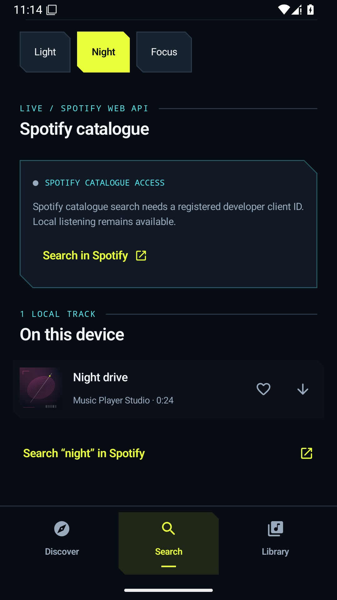
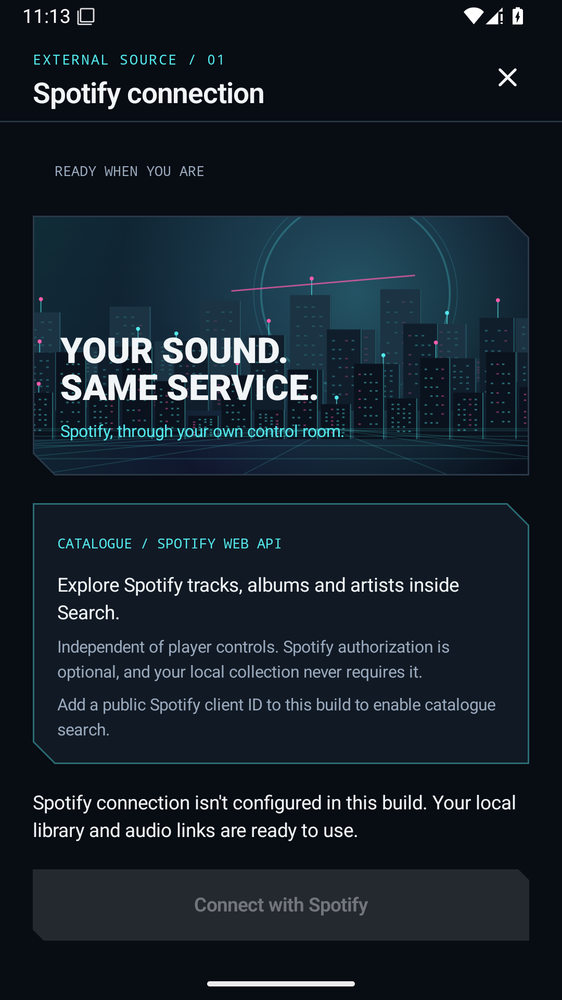
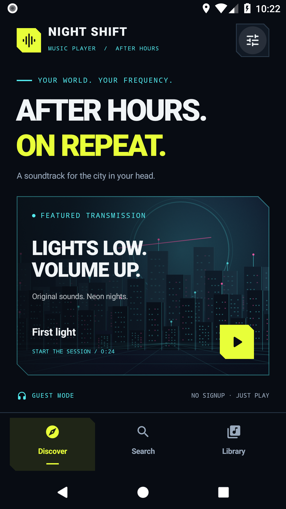
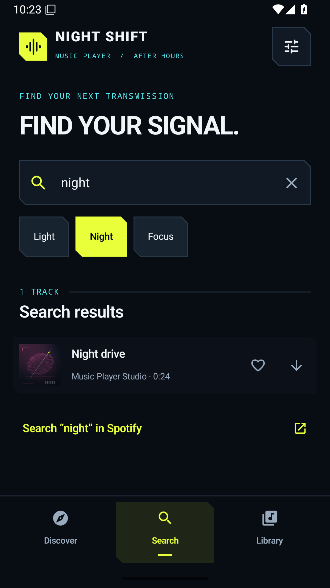
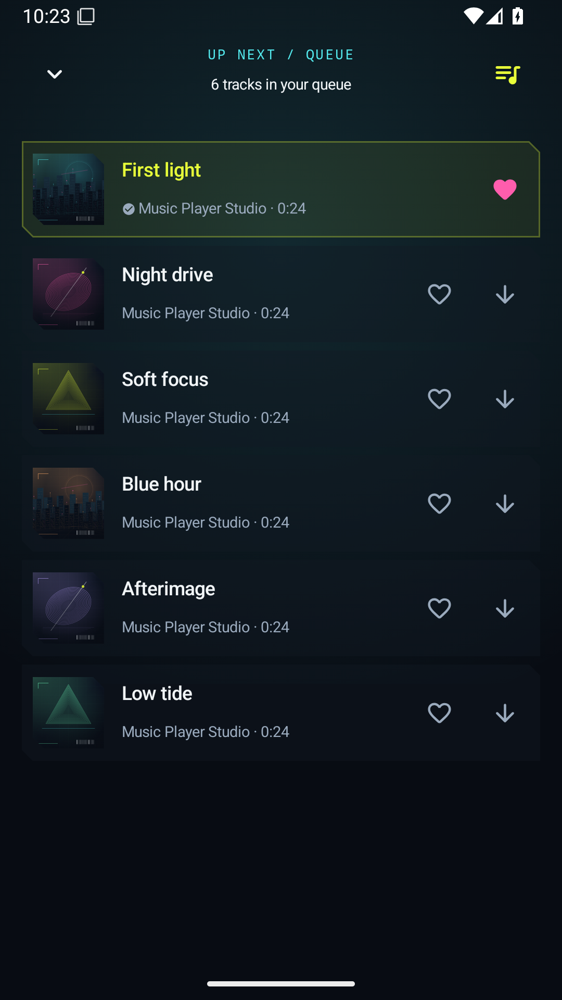

# Music Player

[](https://github.com/cheshmakzanoon-ops/music-player/actions/workflows/android.yml)

An original Android music player with a **NIGHT SHIFT** cyberpunk interface:
blue-black surfaces, acid-yellow controls, cyan details, original animated neon
artwork, real background playback and a persistent offline library. It opens
directly: **no app account, Google signup, or country setup**.

The optional **Spotify catalogue connection** searches actual tracks, albums
and artists through Spotify's Web API inside NIGHT SHIFT, with user-approved
PKCE authorization. Its separate App Remote integration controls playback
through the official Spotify app. Both require a registered Spotify developer
application; the local library needs neither. [Configuration](docs/SPOTIFY_CONNECTION.md).

**New in v0.4.0:** the APK can accept a public Spotify developer Client ID
right inside **Search** or **Settings → Spotify connection**. Enter the ID,
authorize through Spotify and search its catalogue, without rebuilding the app
or creating a NIGHT SHIFT account. The matching loopback callback still needs
registration in the Spotify developer dashboard. Changing the ID securely
disconnects the previous catalogue session. The App Remote SDK continues to
need separate build-time configuration.

### Latest verified build: v0.4.0

**[Android validation run 40217027319](https://github.com/cheshmakzanoon-ops/music-player/actions/runs/40217027319)**
passed for source [c76cb6a](https://github.com/cheshmakzanoon-ops/music-player/commit/c76cb6a423bb30a129536cff20f46a44994e99cd):
Gradle build/JVM tests/lint, **22 Android 8 emulator tests**, **23 Android 15
emulator tests**, and Frida's Android 15 activity-lifecycle smoke check.
The new emulator tests verify in-app Client ID entry and save, persistence,
reset, and Keystore-encrypted token isolation across different Client IDs.

**[Download the verified v0.4.0 APK bundle](https://github.com/cheshmakzanoon-ops/music-player/actions/runs/40217027319/artifacts/12607228735)**
and extract `debug/app-debug.apk`. This is a development-signed test APK; it is
not a store release. The Spotify service did not authorize an account in CI,
so real Spotify catalogue/playback access remains an integration task.
[v0.4.0 emulator evidence](docs/VERIFICATION.md#version-040--runtime-spotify-configuration).

## Catalogue-enabled build — 2026-10-25

**Version 0.3.0** passed the complete [Spotify catalogue integration workflow](https://github.com/cheshmakzanoon-ops/music-player/actions/runs/40188827097)
at tested source revision `cf11d0c`: **16 JVM tests, 19 Android 8 emulator tests, 20 Android 15 emulator
tests**, Android lint (0 errors, 25 warnings), and the Android 15 Frida
lifecycle check. It verifies the in-app catalogue UI, secure PKCE/loopback
authorization components, real Web API request/response parsing against a mock
server, populated Spotify result interaction, and continued account-free local
playback. A real Spotify account was not supplied, so live authorized catalogue
access is still unverified.

[Download the verified v0.3.0 APK](https://github.com/cheshmakzanoon-ops/music-player/actions/runs/40188827097/artifacts/12597327900)
(`debug/app-debug.apk` inside `validation-apks`) or choose the latest green run
from [Android validation](https://github.com/cheshmakzanoon-ops/music-player/actions/workflows/android.yml).
The APK is 22,439,389 bytes, has SHA-256
`de7b78cbdc9704c4b0955643bfda51793927d982a1b244d103c66660181d1d43`,
and passed signature and ZIP-alignment verification. This is a debug build for
testing, not a signed store release.

| Spotify catalogue Search | Spotify connection |
| --- | --- |
|  |  |

Both screenshots are unmodified Android 15 emulator captures from the earlier
successful catalogue build (same UI), showing the honest unconfigured state;
they do **not** depict an authenticated Spotify session.
See [the catalogue verification evidence](docs/VERIFICATION.md#spotify-catalogue-extension--2026-10-25)
and [configuration instructions](docs/SPOTIFY_CONNECTION.md) before distributing
a Spotify-enabled APK.

### Previous verified local-player build

**Version 0.2.0 passed the complete [Android validation run](https://github.com/cheshmakzanoon-ops/music-player/actions/runs/40184075722)**
at source revision `b7b2d3f`: eight JVM tests, 17 Android 8 tests, 18 Android 15
tests, Android lint with zero errors, and the Frida runtime observation.

[Download the tested APK bundle](https://github.com/cheshmakzanoon-ops/music-player/actions/runs/40184075722/artifacts/12595024417)
and install `debug/app-debug.apk` from it. This is a **debug build for testing**, for
Android 8.0 or newer. Its size is 22,373,853 bytes. The exact checksum, test results,
artifact links and remaining verification limits are in [VERIFICATION.md](docs/VERIFICATION.md).

### Actual emulator screenshots

These unmodified captures come from the successful run above. Discover is shown
on Android 8; the player, search and queue are shown on Android 15.

| Discover | Now playing |
| --- | --- |
|  |  |
| Search | Queue |
|  |  |

The [large-text Settings capture](docs/screenshots/settings-large-text-api26.png)
comes from Android 8. The Android 15 Settings capture is stale and is excluded;
the [verification record](docs/VERIFICATION.md#visual-evidence) explains that limitation.

Additional captures: [Spotify connection](docs/screenshots/spotify-connection-api35.png),
[large-text source dialog](docs/screenshots/source-large-text-api35.png), and
[capture provenance](docs/screenshots/README.md).

## What is in this repository

| Part | Purpose |
| --- | --- |
| `app/` | Original Kotlin/Jetpack Compose application, package `io.github.musicplayer`. |
| `catalog/` | Six original procedural studio samples, their HTTPS URLs, checksums, and download permissions. |
| `docs/APK_ANALYSIS.md` | Evidence from static inspection of the supplied reference client. |
| `docs/SPOTIFY_CONNECTION.md` | Supported Spotify integration, configuration and verification limits. |
| `docs/VERIFICATION.md` | Completed CI results, APK identity, reviewed screenshots and known evidence limits. |
| `app/libs/` | Published Spotify App Remote SDK with upstream license, notices and checksum. |
| `reference/` | Unchanged uploaded reference APK, stored with Git LFS. Not included in the new app or its build. |
| `.github/workflows/android.yml` | Build, lint, unit tests, Android emulator tests, APKs, and screenshot artifacts. |

The reference identifies as **Spotify 9.1.78.2215 wrapped with LSPatch**. The rebuild
does not reuse that APK's code, artwork, patch modules, or signing identity. The
official SDK dependency is downloaded separately from Spotify's published release.
See the [analysis report](docs/APK_ANALYSIS.md) and [machine-readable inventory](docs/analysis-metadata.json).

## Listening

- **Discover:** animated original artwork and a studio-sample collection.
- **Search:** filter your available tracks, and optionally search Spotify's
  real tracks, albums and artists with original artwork and Spotify links.
- **Player:** real play/pause, previous/next, seeking, queue, shuffle, repeat, media
  notification, audio focus, headset-disconnect handling, and background playback.
- **Library:** persistent favorites, local imports through Android's file picker,
  HTTPS audio sources, and offline/local filters.
- **Downloads:** explicit saving for permitted direct audio files, progress and errors,
  size/checksum validation when published by the catalogue, atomic writes, and cleanup
  of failed transfers. Completed files remain playable when the server is unavailable.
- **Accessibility:** labelled controls, scalable text, system insets, and a persistent
  reduced-motion setting.
- **Spotify connection:** Spotify Web API metadata search with PKCE authorization,
  plus current-track metadata and artwork, play/pause, content-link
  playback, next/previous, seek, shuffle and repeat through the official app. Controls
  respect Spotify's reported account capabilities and playback restrictions.

First light is bundled so first launch and playback work offline. The other original
samples stream over HTTPS and can be saved. [Sample provenance](catalog/README.md).
Local imports and favorites stay on the device; no analytics or account service is included.

### Spotify integration boundary

**Spotify connection is optional and requires Spotify authorization.** The
catalogue search is an actual Web API integration, independent of the local
library. Its separate original control surface uses the official Spotify app,
which retains its login, backend audio connection, playback, regional
availability and offline entitlements.

Spotify's [supported Android SDK](https://developer.spotify.com/documentation/android)
requires authorization and controls the Spotify app. Removing a client-side signup
screen cannot remove server-side authentication, regional content rules, or download
restrictions. Enter a public Client ID in NIGHT SHIFT (or set the optional
`SPOTIFY_CLIENT_ID` build default) and register the browser callback
`http://127.0.0.1/callback` to enable the catalogue. Separately,
`SPOTIFY_REDIRECT_URI` and a matching APK signing fingerprint enable App Remote.
No identifiers were supplied, so the default build asks you to enter a public
Client ID. Authenticated live catalogue search and playback have not yet been
verified. Spotify's development-mode Web API is currently limited to five
allowlisted users and requires the developer's Premium account. See the
[setup instructions](docs/SPOTIFY_CONNECTION.md).

## Build

Requires **JDK 17**, Android SDK platform 35 and build tools 35.0.0. The Gradle 8.11.1
wrapper and its distribution checksum are pinned. Android Gradle Plugin 8.9.3,
Kotlin 2.1.21, Compose BOM 2025.05.01, and Media3 1.6.1 are pinned for a reproducible
baseline. Minimum Android version is 8.0/API 26; target/compile SDK is 35.

```sh
git clone https://github.com/cheshmakzanoon-ops/music-player.git
cd music-player
# Set ANDROID_HOME to your SDK, or set sdk.dir in an untracked local.properties.
./gradlew testDebugUnitTest lintDebug assembleDebug assembleDebugAndroidTest
```

The installable debug app is `app/build/outputs/apk/debug/app-debug.apk`.
For a release, configure your own signing identity; this project does not include
a private signing key. The debug APK is for testing, not a published store release.

The reference APK is unnecessary to build or run the player. If you only need the
app's source, clone with `GIT_LFS_SKIP_SMUDGE=1`. To reproduce reference analysis,
install Git LFS and run `git lfs pull` before the inspection script.

## Verification

GitHub Actions builds the app, runs JVM tests and Android lint, then installs the
app and instrumentation APKs on **API 26 and API 35 x86-64 Android emulators**.
The tests cover navigation, search/empty results, real playback/seek, favorites,
queue restoration, background playback, source validation, HTTPS streaming,
verified downloads, restart persistence, offline decoding, failure cleanup,
large-font reachability and the optional Spotify connection screen. JVM tests
also validate accepted Spotify share links and reject malformed configuration.

Network/download tests use a real local HTTPS server with a test certificate. The
offline test shuts that server down before reopening the library and playing the
saved file. They do not depend on a paid service account or a live music service.
Emulator screenshots and instrumentation/logcat logs are uploaded as run artifacts.

The [Actions runs](https://github.com/cheshmakzanoon-ops/music-player/actions/workflows/android.yml)
show the actual verification status for each commit. A test suite being present is
not evidence that it passed; consult the run for the revision you download.

## Practical limits

- No player can guarantee every catalogue track in every country at all times.
  Network hosts, authorization, content availability, codecs and Android versions matter.
- The included catalogue is six **24-second original samples**, not commercial music.
- Added sources must be direct HTTPS audio files. Saving supports MP3/AAC/M4A/WAV/FLAC/Ogg
  containers up to 128 MiB; protected streams and playlist downloads are not supported.
- Downloads are managed by the app process, with completed files persisted. An interrupted
  transfer is cleaned up and must be retried; persistent background transfer scheduling
  and resumable downloads are not implemented.
- Imports are copied into private storage (up to 128 MiB), so saved copies do not
  depend on the original file provider remaining online. Uninstalling the app removes
  its private library and downloads.
- Emulator evidence covers the tested Android configurations; it does not establish
  compatibility with every phone or native iOS support.

## Reproduce the reference inventory

```sh
python scripts/inspect_reference_apk.py
```

This checks archive bounds, hashes, signatures, manifest declarations, DEX class
tables and native library metadata. Working files go under ignored `analysis/`.
The [report](docs/APK_ANALYSIS.md) explains the observed overlapping ZIP packaging
and the scope/limitations of JADX, Apktool and Ghidra analysis.
