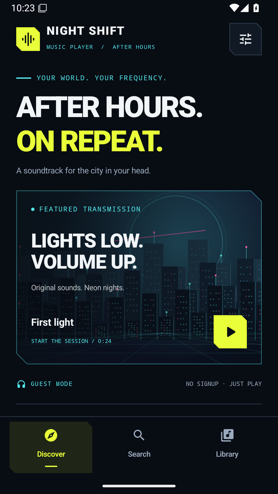
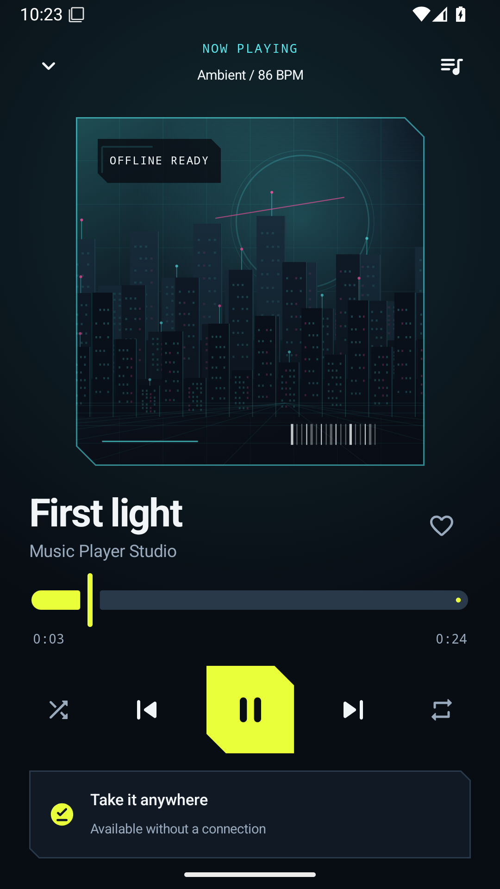

# Music Player

[](https://github.com/cheshmakzanoon-ops/music-player/actions/workflows/android.yml)

An original Android music player with a **NIGHT SHIFT** cyberpunk interface:
blue-black surfaces, acid-yellow controls, cyan details, original animated neon
artwork, real background playback and a persistent offline library. It opens
directly: **no app account, Google signup, or country setup**.

The optional **Spotify connection** uses Spotify's official App Remote SDK to
control its existing app and service. It requires a registered Spotify developer
application and user authorization. [Configuration and verification scope](docs/SPOTIFY_CONNECTION.md).

## Preview

Actual emulator captures from the [successful validation run](https://github.com/cheshmakzanoon-ops/music-player/actions/runs/40184075722).

| Discover · Android 15 | Now Playing · Android 15 |
| --- | --- |
|  |  |

[Spotify connection](docs/screenshots/spotify-connection-api35.png) ·
[Large-text Settings on Android 8](docs/screenshots/settings-large-text-api26.png) ·
[Large-text source dialog on Android 15](docs/screenshots/source-large-text-api35.png) ·
[Capture provenance](docs/screenshots/README.md)

## What is in this repository

| Part | Purpose |
| --- | --- |
| `app/` | Original Kotlin/Jetpack Compose application, package `io.github.musicplayer`. |
| `catalog/` | Six original procedural studio samples, their HTTPS URLs, checksums, and download permissions. |
| `docs/APK_ANALYSIS.md` | Evidence from static inspection of the supplied reference client. |
| `docs/SPOTIFY_CONNECTION.md` | Supported Spotify integration, configuration and verification limits. |
| `app/libs/` | Published Spotify App Remote SDK with upstream license, notices and checksum. |
| `reference/` | Unchanged uploaded reference APK, stored with Git LFS. Not included in the new app or its build. |
| `.github/workflows/android.yml` | Build, lint, unit tests, Android emulator tests, APKs, and screenshot artifacts. |

The reference identifies as **Spotify 9.1.78.2215 wrapped with LSPatch**. The rebuild
does not reuse that APK's code, artwork, patch modules, or signing identity. The
official SDK dependency is downloaded separately from Spotify's published release.
See the [analysis report](docs/APK_ANALYSIS.md) and [machine-readable inventory](docs/analysis-metadata.json).

## Listening

- **Discover:** animated original artwork and a studio-sample collection.
- **Search:** filter your available tracks by title, artist, album, or source.
- **Player:** real play/pause, previous/next, seeking, queue, shuffle, repeat, media
  notification, audio focus, headset-disconnect handling, and background playback.
- **Library:** persistent favorites, local imports through Android's file picker,
  HTTPS audio sources, and offline/local filters.
- **Downloads:** explicit saving for permitted direct audio files, progress and errors,
  size/checksum validation when published by the catalogue, atomic writes, and cleanup
  of failed transfers. Completed files remain playable when the server is unavailable.
- **Accessibility:** labelled controls, scalable text, system insets, and a persistent
  reduced-motion setting.
- **Spotify connection:** current-track metadata and artwork, play/pause, content-link
  playback, next/previous, seek, shuffle and repeat through the official app. Controls
  respect Spotify's reported account capabilities and playback restrictions.

First light is bundled so first launch and playback work offline. The other original
samples stream over HTTPS and can be saved. [Sample provenance](catalog/README.md).
Local imports and favorites stay on the device; no analytics or account service is included.

### Spotify integration boundary

**Spotify connection is optional and requires Spotify authorization.** It provides
an original control surface for the official Spotify app, which retains its login,
backend connection, playback, availability and offline entitlements. Public catalogue
search opens Spotify; the player's local search covers its own collection.

Spotify's [supported Android SDK](https://developer.spotify.com/documentation/android)
requires authorization and controls the Spotify app. Removing a client-side signup
screen cannot remove server-side authentication, regional content rules, or download
restrictions. Set the public `SPOTIFY_CLIENT_ID` and `SPOTIFY_REDIRECT_URI` Actions
variables and register the APK's signing fingerprint to configure the integration.
No identifiers were supplied for this implementation, so the default build clearly
shows that Spotify is not configured. Authenticated Spotify playback has not been
verified. See the [setup instructions](docs/SPOTIFY_CONNECTION.md).

## Install an Actions build

**Verified version 0.2.0:** [Download the APK artifact](https://github.com/cheshmakzanoon-ops/music-player/actions/runs/40184075722/artifacts/12595024417)
from source revision **`b7b2d3f`**. The [run](https://github.com/cheshmakzanoon-ops/music-player/actions/runs/40184075722)
passed 8 JVM tests, lint with zero errors, 17 Android 8 emulator tests, 18 Android 15
emulator tests, and the Android 15 Frida lifecycle check. [Detailed verification record](docs/DEVELOPMENT.md).

Open the [Android validation workflow](https://github.com/cheshmakzanoon-ops/music-player/actions/workflows/android.yml)
and select a completed successful run. Download its **`validation-apks`** artifact,
extract the ZIP, and install **`debug/app-debug.apk`** on an Android 8.0 or newer
device. The run also provides the build reports and separate API 26/API 35
emulator logs and screenshots. These are debug builds for testing; release
distribution uses your own signing identity.

## Build

Requires **JDK 17**, Android SDK platform 35 and build tools 35.0.0. The Gradle 8.11.1
wrapper and its distribution checksum are pinned. Android Gradle Plugin 8.9.3,
Kotlin 2.1.21, Compose BOM 2025.05.01, and Media3 1.6.1 are pinned for a reproducible
baseline. Minimum Android version is 8.0/API 26; target/compile SDK is 35.

```sh
git clone https://github.com/cheshmakzanoon-ops/music-player.git
cd music-player
# Set ANDROID_HOME to your SDK, or set sdk.dir in an untracked local.properties.
./gradlew testDebugUnitTest lintDebug assembleDebug assembleDebugAndroidTest
```

The installable debug app is `app/build/outputs/apk/debug/app-debug.apk`.
For a release, configure your own signing identity; this project does not include
a private signing key. The debug APK is for testing, not a published store release.

The reference APK is unnecessary to build or run the player. If you only need the
app's source, clone with `GIT_LFS_SKIP_SMUDGE=1`. To reproduce reference analysis,
install Git LFS and run `git lfs pull` before the inspection script.

## Verification

GitHub Actions builds the app, runs JVM tests and Android lint, then installs the
app and instrumentation APKs on **API 26 and API 35 x86-64 Android emulators**.
The tests cover navigation, search/empty results, real playback/seek, favorites,
queue restoration, background playback, source validation, HTTPS streaming,
verified downloads, restart persistence, offline decoding, failure cleanup,
large-font reachability and the optional Spotify connection screen. JVM tests
also validate accepted Spotify share links and reject malformed configuration.

Network/download tests use a real local HTTPS server with a test certificate. The
offline test shuts that server down before reopening the library and playing the
saved file. They do not depend on a paid service account or a live music service.
Emulator screenshots and instrumentation/logcat logs are uploaded as run artifacts.

The [Actions runs](https://github.com/cheshmakzanoon-ops/music-player/actions/workflows/android.yml)
show the actual verification status for each commit. A test suite being present is
not evidence that it passed; consult the run for the revision you download.

The verified delivery's application source is `b7b2d3f`; later documentation and
screenshot-only commits do not trigger another build. Its lint report contains
20 warnings and zero errors. The API 29+ document-provider import fixture runs on
API 35, which accounts for the 18-versus-17 emulator test counts.

## Practical limits

- No player can guarantee every catalogue track in every country at all times.
  Network hosts, authorization, content availability, codecs and Android versions matter.
- The included catalogue is six **24-second original samples**, not commercial music.
- Added sources must be direct HTTPS audio files. Saving supports MP3/AAC/M4A/WAV/FLAC/Ogg
  containers up to 128 MiB; protected streams and playlist downloads are not supported.
- Downloads are managed by the app process, with completed files persisted. An interrupted
  transfer is cleaned up and must be retried; persistent background transfer scheduling
  and resumable downloads are not implemented.
- Imports are copied into private storage (up to 128 MiB), so saved copies do not
  depend on the original file provider remaining online. Uninstalling the app removes
  its private library and downloads.
- Emulator evidence covers the tested Android configurations; it does not establish
  compatibility with every phone or native iOS support.

## Reproduce the reference inventory

```sh
python scripts/inspect_reference_apk.py
```

This checks archive bounds, hashes, signatures, manifest declarations, DEX class
tables and native library metadata. Working files go under ignored `analysis/`.
The [report](docs/APK_ANALYSIS.md) explains the observed overlapping ZIP packaging
and the scope/limitations of JADX, Apktool and Ghidra analysis.
